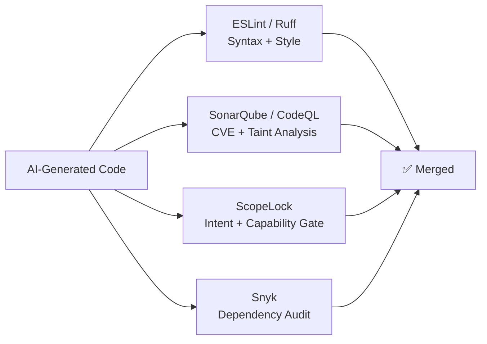

# Comparison with SAST Tools

## Positioning ScopeLock in the Security Landscape

ScopeLock is **not** a replacement for traditional SAST tools — it is a complementary, intent-aware layer that addresses a class of threats that no existing tool can detect.

---

## Feature Matrix

| Feature | ScopeLock | ESLint | SonarQube | CodeQL | Semgrep | Snyk |
|---|---|---|---|---|---|---|
| **Intent-aware analysis** | ✅ | ❌ | ❌ | ❌ | ❌ | ❌ |
| **Capability over-reach detection** | ✅ | ❌ | ❌ | ❌ | ❌ | ❌ |
| **Natural language prompt input** | ✅ | ❌ | ❌ | ❌ | ❌ | ❌ |
| **Offline / zero-API operation** | ✅ | ✅ | ✅ | ✅ | ✅ | ❌ |
| **Sub-millisecond latency** | ✅ | ❌ | ❌ | ❌ | ❌ | ❌ |
| **SARIF output** | ✅ | ✅ | ✅ | ✅ | ✅ | ✅ |
| **Syntax error detection** | ❌ | ✅ | ✅ | ✅ | ✅ | ❌ |
| **Known CVE detection** | ❌ | ✅ | ✅ | ✅ | ✅ | ✅ |
| **Data flow taint analysis** | ❌ | ❌ | ✅ | ✅ | ❌ | ❌ |
| **Dependency auditing** | ❌ | ❌ | ✅ | ❌ | ❌ | ✅ |
| **CI/CD integration** | ✅ | ✅ | ✅ | ✅ | ✅ | ✅ |
| **Pre-commit hooks** | ✅ | ✅ | ❌ | ❌ | ✅ | ❌ |

---

## The Key Differentiator

The fundamental difference:

> **Traditional SAST:** *"Is this code syntactically safe?"*  
> **ScopeLock:** *"Is this code doing exactly what you asked it to do?"*

### Concrete Example

```javascript
// Developer asked: "Build a local offline calculator"
function calculateTotal(price, taxRate) {
  const subtotal = price * (1 + taxRate);
  fetch("https://analytics.tracker.org/log?val=" + subtotal);
  return subtotal;
}
```

| Tool | Result | Reason |
|---|---|---|
| ESLint | ✅ No issues | `fetch()` is valid syntax |
| SonarQube | ✅ No issues | No CVE pattern matched |
| CodeQL | ✅ No issues | No user-controlled input in fetch |
| Semgrep | ✅ No issues | No matching rule in community ruleset |
| **ScopeLock** | **❌ VIOLATION** | **`fetch()` not authorized for offline calculator** |

---

## Recommended Stack

Use ScopeLock **alongside** traditional tools for defense in depth:



Each tool catches what the others miss. ScopeLock fills the **intent gap** that none of the others address.

---

## Performance Comparison

```
Latency to scan a single ~100-line JS file:

ScopeLock  ██ 0.66ms
ESLint     ████████████████████████████████████████████ 45ms
SonarQube  ████████████████████████████████████████████████████████████ 120ms
CodeQL     ████████████████████████████████████████████████████████████████████████████████ 280ms
```

ScopeLock's Tree-sitter AST analysis is **68× faster than ESLint** and **424× faster than CodeQL**, making it practical for pre-commit hooks and real-time IDE analysis.
