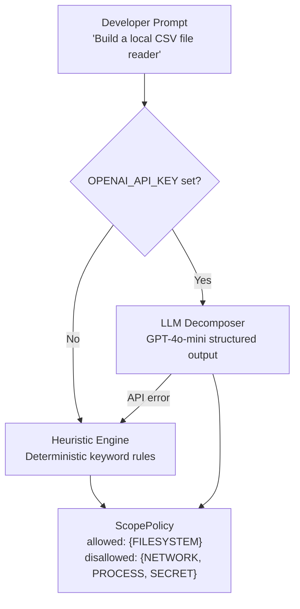

# Intent Engine

The **Intent Decomposer Engine** translates natural-language developer prompts into formal `ScopePolicy` contracts — the expected capability set that the code is authorized to use.

---

## Architecture



---

## Heuristic Engine (Offline / Default)

The `HeuristicIntentEngine` uses deterministic keyword matching. It requires **zero API calls** and completes in **< 0.1ms**.

### Keyword Rules

| Category Granted | Trigger Keywords |
|---|---|
| `NETWORK` | `fetch`, `http`, `api`, `weather`, `download`, `request`, `url`, `rest`, `endpoint`, `scrape`, `server`, `webhook` |
| `FILESYSTEM` | `file`, `csv`, `json`, `read`, `write`, `save`, `log`, `directory`, `folder`, `disk`, `backup`, `txt`, `export` |
| `PROCESS` | `shell`, `command`, `bash`, `execute`, `run process`, `terminal`, `spawn`, `exec`, `cli command` |

### Strict Offline Mode

These keywords **override** all others and deny everything:

`calculator`, `math`, `arithmetic`, `matrix`, `sort`, `unit converter`, `fibonacci`, `factorial`, `offline`, `pure function`

If any of these appear, the policy denies NETWORK even if `request` is also in the prompt.

### Ambiguity Detection

These phrases trigger the `NEEDS_REVIEW` state:

`manage my stuff`, `do whatever`, `general utility`, `system tool`

---

## LLM Decomposer (Enhanced Mode)

When `OPENAI_API_KEY` is set, ScopeLock uses GPT-4o-mini with **structured output** (JSON schema enforcement) to parse intent:

```python
# The LLM receives this system prompt:
"You are a formal security analyst. Convert the natural language requirement
into a strict capability policy. Do not hallucinate permissions.
If an offline utility is requested, allow zero permissions."
```

The response is validated against the `ScopePolicy` Pydantic schema — the LLM cannot invent new fields or permission types.

**Fallback:** If the API call fails for any reason, ScopeLock transparently falls back to the heuristic engine. You are never blocked.

---

## The `ScopePolicy` Contract

Every audit produces a `ScopePolicy`:

```json
{
  "application_name": "Arithmetic Calculator CLI",
  "stated_intent": "Build a local offline calculator",
  "allowed_categories": [],
  "disallowed_categories": ["NETWORK", "FILESYSTEM", "PROCESS", "SECRET", "RUNTIME"],
  "expected_capabilities": [],
  "is_ambiguous": false
}
```

For a network-enabled app:

```json
{
  "application_name": "Weather Client",
  "stated_intent": "Fetch weather data from OpenWeatherMap for a city",
  "allowed_categories": ["NETWORK"],
  "disallowed_categories": ["FILESYSTEM", "PROCESS", "SECRET", "RUNTIME"],
  "expected_capabilities": [
    {
      "category": "NETWORK",
      "action": "*",
      "target_scope": "*",
      "justification": "Prompt explicitly mentions fetching weather data from an external API"
    }
  ],
  "is_ambiguous": false
}
```

---

## Writing Better Prompts

The more specific your `@intent:` annotation, the more accurate the policy:

| ❌ Vague | ✅ Specific |
|---|---|
| `"Calculator app"` | `"Local arithmetic calculator — no network or file access"` |
| `"File utility"` | `"Read local CSV file and return parsed rows"` |
| `"Weather app"` | `"Fetch live weather from OpenWeatherMap REST API for a given city"` |
| `"Auth module"` | `"Authenticate users via JWT — reads from PostgreSQL, no subprocess"` |
